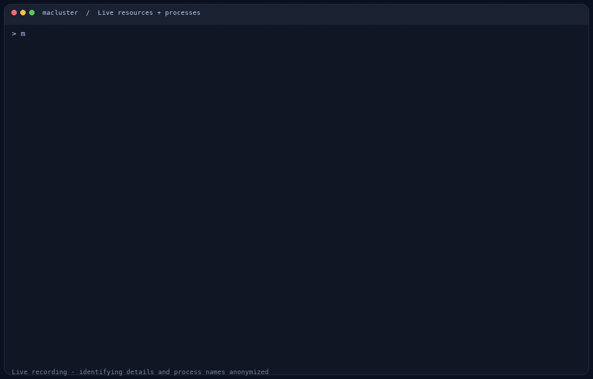
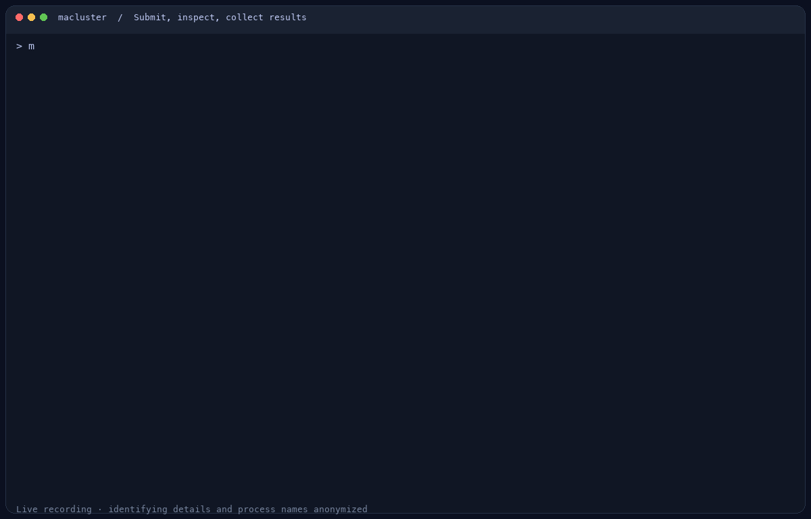
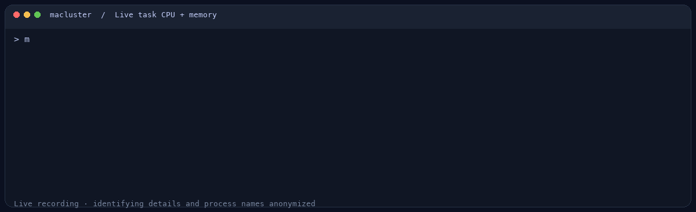

# macluster

Turn your Macs into a personal compute cluster. Submit commands from one Mac, run them on another, and monitor the cluster in your terminal.

English · [简体中文](doc/README.zh-CN.md) · [Agent skill](skills/macluster/SKILL.md)

Written in Rust. One binary to distribute. SSH connects nodes; NFS or SMB shares projects, software, and external storage.



*Select a Mac, open its processes, and switch between CPU and memory sorting. These are live recordings; identifying details and process names are anonymized.*

## How it works

```text
Login clients                     Login Mac / Controller             Compute Macs
CLI over pinned SSH        ───►   CLI + background service    ───►   One job per Mac
Optional NFS mount          ◄──►   NFS storage by default       ◄──►   Shared projects and tools
```

The Mac running the controller stays outside compute queues. Another Mac can join the same cluster as a login client and submit or inspect work without becoming a compute node. Jobs occupy a whole compute node, with no CPU-core or memory quota. You can choose a separate storage Mac during setup.

This is an early-stage project for personal and lab clusters. It uses macOS accounts and shared storage as its trust boundary.

## Install

Requirements: macOS 12+, Remote Login enabled on compute Macs, and SSH access from the login Mac. The checked-in `rust-toolchain.toml` installs the stable compiler, clippy, rustfmt, and rust-analyzer for source builds.

On Apple silicon, install the latest release with Homebrew:

```sh
brew install FJingxian/macluster/macluster
brew upgrade macluster
```

The tap formula is updated automatically after a GitHub release. Intel Macs and source installs can use the commands below.

Build and install on the Mac you want to use as the login node:

```sh
scripts/release/build_signed_macos.sh
packaging/scripts/install-user.sh
export PATH="$HOME/.local/bin:$PATH"
```

The build script prefers a `Developer ID Application` identity and otherwise
uses an installed `Apple Development` identity. It fixes the code identifier to
`org.macluster.macluster`, enables the hardened runtime, and verifies that the
designated requirement does not depend on the changing executable CDHash. An
Apple Development identity is sufficient for stable local TCC identity. Public
downloads without a Gatekeeper warning require a paid Developer ID membership,
notarization, and release secrets documented in [releasing.md](doc/releasing.md).
Developers without an Apple signing identity can still use
`cargo build --release --locked -p macluster-cli`, which produces an ad-hoc
signature.

Add the PATH line to your shell configuration. To distribute the app, copy only `target/release/macluster`; the power/fan helper is embedded. Rust and Python are not required to run macluster. Use a binary supporting the target Mac's CPU architecture.

Copying the binary alone provides `macluster SUBCOMMAND`. Short commands such as `mtop` are symlinks created by the installer. For a downloaded binary, run `packaging/scripts/install-user.sh /path/to/macluster "$HOME/.local/bin"`, then add that directory to `PATH`.

Examples use the full command. The installer also provides `msub`, `mjob`, `mqueue`, `mkill`, `mtop`, `mnode`, and `mfans` command aliases. Controller commands remain available for manual service maintenance but are omitted from the main help.

Release signing, notarization, and the Homebrew tap are documented in [releasing.md](doc/releasing.md).

## Start a cluster

```sh
# Run on the login Mac. Setup is interactive.
macluster --init --name home --queue default --shared-root /Users/Shared/macluster

# Replace the SSH account and address with your compute Mac.
macluster node -a worker@192.0.2.10
macluster node -l
macluster node -l default-001
```

Nodes enter the cluster after enrollment verifies the Agent and shared storage. `node -l` gives a compact cluster view; append one node ID to show that Mac's host, SSH account, port, and detailed storage information. Failed enrollment attempts are kept separately for retry. Inspect them with `macluster node --failed`. Enrollment installs the Agent and configures shared storage. It can install an SSH key after you verify the fingerprint and enter the remote account's login password. NFS and privileged helper setup may separately require administrator authorization on each affected Mac.

All Agent-managed Macs appear in `mtop`, `mqueue`, and `mfans`, including a controller or login client that has no compute role. `mnode` reports only the `controller` and `compute` roles; NFS/SMB ownership is shown through storage mappings instead. External NFS/SMB providers have no compatible Agent and appear only as storage mappings. Queue rows continue to evaluate scheduling eligibility separately. `mnode -l --storage` refreshes system, external-volume, and mounted-share capacity in a bounded pass; plain `mnode -l` uses cached capacity where available.

Submission snapshots move from controller-local state to the storage Agent in bounded chunks, and the selected compute Agent receives the job script before `StartJob`. The controller therefore does not need direct NFS access to publish or launch a job. Job inputs, outputs, and log synchronization still depend on the configured shared storage being reachable from the nodes that use it.

Initialization installs a per-user background LaunchAgent. Closing Terminal does not stop the controller; logging out of that macOS user session does. Scheduling needs the controller. Job and queue queries can read persisted state while it is stopped.

```sh
macluster controller status
macluster controller start
macluster controller stop
```

`controller run` runs in the foreground for troubleshooting. Do not run `macluster --init` just to start the controller: when a configuration exists, it offers to reset it.

## Use another Mac as a login client

Run the same binary on another Mac and join the existing controller:

```sh
macluster --join cluster-user@192.0.2.1
macluster --clusters
macluster queue
macluster submit hostname
```

The command installs a dedicated SSH key and a cluster-specific SSH host pin. By default it also mounts the primary and named NFS shares and installs a root LaunchDaemon that remounts them after reconnect. If a mount would hide existing local files, macluster lists those paths and requires `y`. Use `--join --control-only` when the Mac only needs queue, job, node, and monitoring access without mounting cluster storage.

When one compatible cluster is discoverable on the local network, an ordinary command such as `mtop` offers to join it. macOS may ask for Local Network permission on first discovery; denying it only disables automatic discovery, not the explicit `--join` flow.

```sh
macluster --cluster home mtop
macluster --cluster home --leave
```

`--cluster` accepts a profile name or full UUID and overrides a local controller configuration for that command. `--leave` stops the client mount service, detaches its mounts, revokes that client's NFS export entries and SSH key, then removes the local profile. A failed cleanup leaves the profile intact so the same command can be retried.

The controller records the SSH peer's IPv4 address and adds only that address to the managed NFS exports. The first join or a later address change may therefore trigger administrator authorization on the controller or its NFS servers. Rejoining with the same client key reuses its identity.

## Run jobs



*One workflow: submit → running → completed → captured output.*

```sh
macluster submit hostname                       # Batch command
macluster submit job.sh                         # Batch script
macluster submit -q default --node default-001 hostname
macluster submit -Is python --version           # Attached command; needs a TTY
macluster submit -Is                            # Interactive shell

macluster job                                  # Active jobs
macluster job --all                             # Include finished jobs
macluster job 1                                # Details; replace 1 with your job ID
macluster job --log 1                          # Captured output
macluster queue
macluster kill 1
```

Task arguments go after the command. Quote shell operators so they execute on the compute Mac:

```sh
macluster submit --wrap 'python analysis.py > analysis.log 2>&1'
macluster submit -v python analysis.py          # Optional detailed resource log
```

Detailed timestamped CPU/memory logging is **off by default**; enable it with `submit -v`.

**Where files go:** submitting inside a registered share uses that directory. Inline commands submitted outside all shares use the primary shared root; `--cwd PATH` explicitly selects a shared directory. Relative output files are written there. Default captured logs synchronize to the primary share after completion. Compute nodes cannot read arbitrary unshared files on the login Mac.

## Watch one task's CPU and memory



*A live subscription to a short synthetic task. No verbose logging is required; closing the subscription leaves the task running.*

```sh
macluster job --metrics 1
macluster job --metrics 1 --follow --json
```

This subscribes to process-group CPU/RSS through the running controller, even if the task was submitted without `-v`. Multiple viewers share one sample about every five seconds. Closing the subscription stops on-demand collection; it does not cancel the job. The first CPU value is null until a second observation is available. `--follow --json` emits JSON Lines and stops at job completion.

This is live sampled data, not complete lifetime accounting. See [task resource subscriptions](doc/job-resources.md) for the IPC interface, measurement limits, and overhead. `job --log --follow` still waits for completed output publication; it is not a live output stream.

## Share projects and environments

```sh
# Mount a project exported by the login Mac at the same path on every node.
macluster node -mount nfs://login-01/Users/yourname/projects/example \
  --mount-root /Users/yourname/projects/example

# Mount the shared software environment.
macluster node -mount nfs://login-01/Users/yourname/mamba \
  --mount-root /Users/yourname/mamba
```

Activate your environment in the login terminal, enter the shared project, then submit:

```sh
macluster submit -Is python --version
macluster submit -Is pip install -e .
```

`submit` forwards exported environment variables and maps registered shared paths. **The software files must also be shared.** An active environment must resolve at the same absolute path on every node. Unshared toolchains are not replaced silently with compute-local software; standard macOS commands remain available. `HOME` follows the submitting Mac so `~` resolves against the same shared paths; shell aliases/functions and node-specific user, temporary-directory, and SSH-agent values are not forwarded.

Environment variables are stored with jobs: avoid exporting secrets. Avoid concurrent installs into the same shared environment. A software share can hide an existing installation at its mount path; inspect mappings before changing them.

Use an NFS-exportable volume such as APFS; ExFAT cannot be exported. Protected folders and external volumes may require Full Disk Access for `/sbin/nfsd` on the **storage Mac**. After granting it, restart nfsd there and retry enrollment.

### Recover a wedged macOS NFS client

If an NFS mount remains visible but reads fail with `Interrupted system call`
(`EINTR`), run:

```sh
macluster node --repair-nfs COMPUTE_NODE_ID
```

The command uses a bounded five-second probe and offers recovery only for a
confirmed `EINTR` wedge on an idle SSH compute node. It refuses login,
controller, storage-only, busy-job, and pending-output states. After `y`, the
Agent installs an atomic job barrier and the privileged helper schedules one
boot-ID-bound reboot. Success requires the node to disconnect, reconnect, and
read every configured NFS marker again.

`--yes` supports explicitly unattended use. It skips only the terminal prompt;
all wedge, identity, idle, output-sync, and boot-ID checks still apply.

For a NAS or another external storage provider, mount it directly. It is not
added to the node list:

```sh
macluster node -mount smb://nas-user/data --mount-root /Users/Shared/nas-data \
  --host 192.0.2.5 --smb-user nas-user

macluster node -mount smb://192.0.2.5/data \
  --mount-root /Volumes/test_data --smb-user nas-user

macluster node -mount nfs://nas-01/export/data \
  --mount-root /Volumes/nas-data --host 192.0.2.5
```

The server ID in the URI can be a logical name while `--host` provides its IPv4
address or DNS name. An IPv4 address or DNS name can also be used directly in
the URI; the CLI creates a stable internal alias automatically. The first new
server/account asks for the SMB password once with hidden input. The controller
stores the validated master password in a root-only credential vault under
`/Library/PrivilegedHelperTools/org.macluster.credentials` (mode `0700`, item
files mode `0600`); every reachable node then receives it through pinned SSH
stdin and stores the node copy in the same root-only vault. The privileged
helper runs `mount_smbfs` in the target user's launchd security context and
feeds the password through a pseudo-terminal.
If `--smb-user` is omitted in an interactive terminal, macluster asks for the
user and defaults a blank response to `guest` without password storage.
Rejected credentials can be retried three times. A missing share is reported
before any password prompt, with the server's discoverable first-level shares.
If the same SMB source is already mounted at another path, the CLI asks whether
to reuse that mount for the requested target; answering `n` cancels without
changing the existing mount.
Passwords do not enter cluster configuration, SQLite, journals, job environment,
command arguments, temporary files, or logs. The per-user LaunchAgent asks the
helper to restore the mount; reconnecting nodes receive a fresh root-only node
credential from the login Mac's vault.
An `mnode -a USER@NAS_ADDRESS` attempt is redirected to this direct-mount
workflow and never enrolls the NAS as a cluster node.

If an SMB mount remains in the mount table but fails readability, macluster
replaces it once: it performs a bounded unmount, repairs same-subnet route and
ARP state, reconnects with the stored credential, verifies the mount, and
restores the logical path. A busy unmount is preserved and reported. Repeated
failures use bounded backoff rather than repeated forced detaches.

To remove an SMB mapping:

```sh
macluster node -umount 01234567
macluster node -umount 01234567 --force
macluster node -umount 01234567 --force --yes
macluster node -umount 01234567 --wait --timeout 60
```

The default is non-blocking: the mapping is removed immediately and the
logical path disappears even if the kernel mount is busy. Physical cleanup is
retried after 15, 30, and 60 seconds, then every 5 minutes. `--force` asks once
before force-detaching failed nodes; `--yes` skips that prompt for automation.
`--wait` follows the background retry and defaults to a 300-second limit.
`macluster node --failed` shows attempts, failure category, and next retry.
When a mapping has already been removed but its physical mount remains busy,
the pending share UUID printed by `node --failed` can be targeted directly:

```sh
macluster node -umount CLEANUP_SHARE_UUID --force --yes
macluster node -umount CLEANUP_SHARE_UUID --wait
```

This removes only the named pending cleanup and preserves other entries in
the same journal record.
Legacy managed SMB helper state that is no longer in the configuration is
adopted automatically so an old hidden mount cannot leave a dangling `~` path.

During an interactive reset, an old SSH-managed node without key login prompts
once for that node account so macluster can install its dedicated reset key and
finish exact remote cleanup. A stale local machine UUID does not block local
reset cleanup.

Use `--update-credential` to validate and rotate the password before replacing the old master. Validation forces a fresh SMB session so an existing mount cannot make a wrong password appear valid. Offline nodes receive the new generation automatically after reconnect. Removing the last share for a server/account schedules cleanup of the master and node vault entries.

Inspect the mapping ID, canonical source URI, and local target with `mnode -l`. Remove a managed mount through either endpoint:

```sh
macluster node -umount d2d3885d
macluster node -umount smb://nas-user/data
```

`mnode --scan` identifies SMB and NFS service candidates on the cluster subnet. It cannot safely enumerate authenticated SMB shares or NFS exports, so mountable paths come from the NAS/provider administrator or a known share URI.

Older shares without `smb_user` migrate in place by rerunning `mnode -mount` with the same URI, the same mount root, and `--smb-user ACCOUNT`. This preserves the existing share ID and UUID and does not create a duplicate:

```sh
macluster node -mount smb://nas-user/data --mount-root /Users/Shared/nas-data \
  --host 192.0.2.5 --smb-user nas-user
```

## Monitor

```sh
macluster top                                  # Terminal dashboard
macluster top --once                           # One-shot table
```

In the terminal: arrows or `j`/`k` select a node, Enter opens/closes process details, `c` sorts processes by CPU, `m` by memory, and `q` quits. Details first show a fast preview, then replace it with interval samples. The preview labels its average CPU and RSS memory.

CPU usage is summed across logical CPUs: an eight-CPU Mac can reach 800%. GPU, temperature, fan, and power readings depend on hardware/helper support; unavailable readings show `N/A`.

`mqueue` is also available as `macluster queue`.

## Maintenance

| Command | Purpose |
| --- | --- |
| `macluster node -l` | Registered nodes and common NFS/SMB mappings |
| `macluster node --failed` | Unfinished enrollment/share/removal errors |
| `macluster node -rm NODE_ID` | Remove an idle compute node; share servers need storage migration first |
| `macluster node -rm NODE_ID --connect USER@IP[:PORT]` | Reach a moved node and verify its registered identity before removal |
| `macluster node -umount MAPPING_ID\|SOURCE_URI` | Detach a named NFS/SMB mount using the eight-character ID or source URI shown by `node -l` |
| `macluster fans --status [--node ID]` | Fan policy and support |
| `macluster fans --auto [--node ID]` | Linear 40–80°C temperature curve |
| `macluster fans --power [--node ID]` | Logarithmic 40–80°C temperature curve |
| `macluster fans --reset [--node ID]` | Restore macOS fan control |
| `macluster --init` | Confirm reset, archive old state, and configure a new cluster |
| `macluster --init --force` | Allow dropping pending output sync for finished jobs; active jobs still block reset |

Reset cleans managed NFS and SMB mounts/exports and preserves shared data files. Read its confirmation carefully. Fan control uses a private AppleSMC interface and depends on the Mac model; unsupported nodes remain under system control.

Local initialization installs the power sampler. Interactive `mtop` can separately request authorization to install or repair it; declining still allows monitoring other resources. Brief power-read failures retain the last valid reading with its age and error, for at most the existing 60-second validity window. Apple Silicon MacBook Air models have no fan, so fan speed is N/A.

Agent updates trigger automatically for known build mismatches. Privileged services have independent versions: ordinary Agent updates reuse current services. Initial installation, a service upgrade, or repair can require administrator authorization on each affected Mac. Passwords are not stored.

For a separate storage Mac:

```sh
macluster --init --name home --queue default \
  --primary-nfs 'storage@198.51.100.10:22:/Volumes/Data/macluster' \
  --shared-root /Users/Shared/macluster
```

The storage Mac stays outside compute queues. Same-subnet IP changes can retain node IDs after SSH trust and machine identity are verified. Migration waits for active work to drain and may require authorization for NFS changes.

Interactive controller migration lists forceable blockers and asks once. Answering `y` force-cancels active jobs and attach sessions, carries deferred offline-Mac helper work to the new controller, and completes the migration. Target identity, build, storage, credential, and controller-stop failures remain hard errors.

## Troubleshooting

| Symptom | First check |
| --- | --- |
| Job stays pending | `controller status`, `job JOBID`, and `node -l`; the queue needs a ready compute node |
| Python/compiler missing | Activate the intended environment and share its installation path |
| Wrong working directory | `node -l` mappings; submit from a share or use `--cwd` |
| NFS export denied | Filesystem, permissions, and nfsd privacy authorization on the storage Mac |
| Login client cannot discover a cluster | Allow Local Network access, or run explicit `--join USER@HOST[:PORT]` |
| Login client storage is stale after an IP change | Run a storage-dependent command such as `submit`; its next controller connection updates the recorded NFS client address |
| Controller failed to start | `controller status`; logs in `~/Library/Logs/macluster/` |

Use `macluster --help` or `macluster submit --help` for options. Keep SSH host-key checking enabled; verify changed fingerprints before updating trust.

## Agent skill

The bundled [macluster skill](skills/macluster/SKILL.md) helps an agent inspect the cluster, submit jobs, respect environment/path semantics, and diagnose failures.

Install it for Codex from this repository:

```sh
mkdir -p "${CODEX_HOME:-$HOME/.codex}/skills"
cp -R skills/macluster "${CODEX_HOME:-$HOME/.codex}/skills/"
```

Example: “Use `$macluster` to submit my analysis from the current shared directory and check the output.”

## License

[GNU GPL v3 or later](LICENSE) (`GPL-3.0-or-later`). Commercial use is allowed under the GPL; redistribution must meet its license and source-code requirements.
