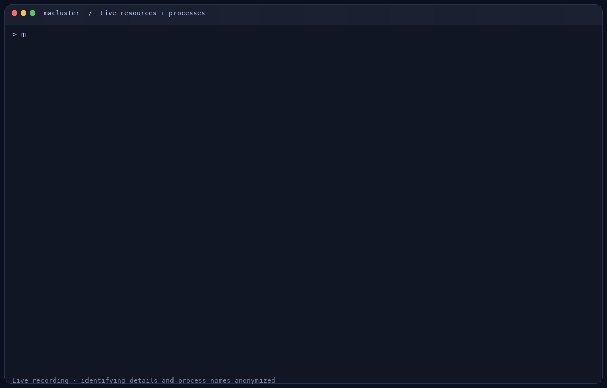
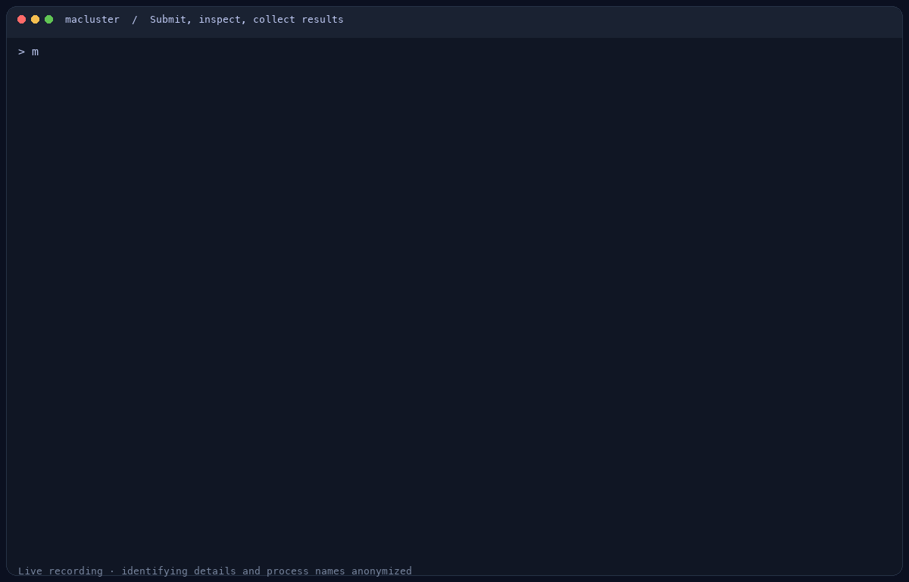
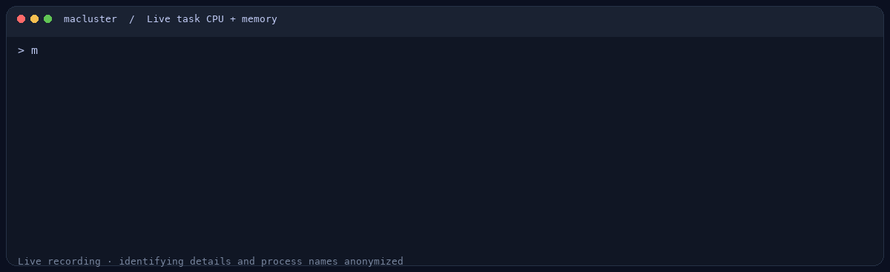

# macluster

Turn your Macs into a personal compute cluster. Submit commands from one Mac, run them on another, and monitor the cluster in your terminal or browser.

English · [简体中文](doc/README.zh-CN.md) · [Agent skill](skills/macluster/SKILL.md)

Written in Rust. One binary to distribute. SSH connects nodes; NFS shares projects, software, and results.



*Select a Mac, open its processes, and switch between CPU and memory sorting. These are live recordings; identifying details and process names are anonymized.*

## How it works

```text
Login Mac                         Compute Macs
CLI + background controller  ───►  One job per Mac
NFS storage by default       ◄──►  Shared projects and tools
```

The login Mac stays outside compute queues. Jobs occupy a whole compute node, with no CPU-core or memory quota. You can choose a separate storage Mac during setup.

This is an early-stage project for personal and lab clusters. It uses macOS accounts and shared storage as its trust boundary.

## Install

Requirements: macOS 12+, Remote Login enabled on compute Macs, and SSH access from the login Mac. Building requires Rust 1.90+.

Build and install on the Mac you want to use as the login node:

```sh
cargo build --release --locked -p macluster-cli
packaging/scripts/install-user.sh
export PATH="$HOME/.local/bin:$PATH"
```

Add the PATH line to your shell configuration. To distribute the app, copy only `target/release/macluster`; the power/fan helper is embedded. Rust and Python are not required to run macluster. Use a binary supporting the target Mac's CPU architecture.

Examples use the full command. The installer also provides `msub`, `mjob`, `mqueue`, `mkill`, `mtop`, and `mnode` aliases.

## Start a cluster

```sh
# Run on the login Mac. Setup is interactive.
macluster init --name home --queue default --shared-root /Users/Shared/macluster

# Replace the SSH account and address with your compute Mac.
macluster node -a worker@192.0.2.10
macluster node -l
```

Nodes enter the cluster after enrollment verifies the Agent and shared storage. `node -l` lists registered nodes as READY or OFFLINE; failed enrollment attempts are kept separately for retry. Inspect them with `macluster node --failed`. Enrollment installs the Agent and configures shared storage. It can install an SSH key after you verify the fingerprint and enter the remote account's login password. NFS and privileged helper setup may separately require administrator authorization on each affected Mac.

Initialization installs a per-user background LaunchAgent. Closing Terminal does not stop the controller; logging out of that macOS user session does. Scheduling needs the controller. Job and queue queries can read persisted state while it is stopped.

```sh
macluster controller status
macluster controller start
macluster controller stop
```

`controller run` runs in the foreground for troubleshooting. Do not initialize again just to start the controller: when a configuration exists, `init` offers to reset it.

## Run jobs



*One workflow: submit → running → completed → captured output.*

```sh
macluster submit hostname                       # Batch command
macluster submit job.sh                         # Batch script
macluster submit -q default --node default-001 hostname
macluster submit -Is python --version           # Attached command; needs a TTY
macluster submit -Is                            # Interactive shell

macluster job                                  # Active jobs
macluster job --all                             # Include finished jobs
macluster job 1                                # Details; replace 1 with your job ID
macluster job --log 1                          # Captured output
macluster queue
macluster kill 1
```

Task arguments go after the command. Quote shell operators so they execute on the compute Mac:

```sh
macluster submit --wrap 'python analysis.py > analysis.log 2>&1'
macluster submit -v python analysis.py          # Optional detailed resource log
```

Detailed timestamped CPU/memory logging is **off by default**; enable it with `submit -v`.

**Where files go:** submitting inside a registered share uses that directory. Inline commands submitted outside all shares use the primary shared root; `--cwd PATH` explicitly selects a shared directory. Relative output files are written there. Default captured logs synchronize to the primary share after completion. Compute nodes cannot read arbitrary unshared files on the login Mac.

## Watch one task's CPU and memory



*A live subscription to a short synthetic task. No verbose logging is required; closing the subscription leaves the task running.*

```sh
macluster job --metrics 1
macluster job --metrics 1 --follow --json
```

This subscribes to process-group CPU/RSS through the running controller, even if the task was submitted without `-v`. Multiple viewers share one sample about every five seconds. Closing the subscription stops on-demand collection; it does not cancel the job. The first CPU value is null until a second observation is available. `--follow --json` emits JSON Lines and stops at job completion.

This is live sampled data, not complete lifetime accounting. See [task resource subscriptions](doc/job-resources.md) for the IPC interface, measurement limits, and overhead. `job --log --follow` still waits for completed output publication; it is not a live output stream.

## Share projects and environments

```sh
# Share a project at the same path on every node.
macluster node -a "local:$HOME/projects/example" --share-id project \
  --mount-root "$HOME/projects/example"

# Share the installation containing your software environment.
macluster node -a "local:$HOME/mamba" --share-id mamba \
  --mount-root "$HOME/mamba"
```

Activate your environment in the login terminal, enter the shared project, then submit:

```sh
macluster submit -Is python --version
macluster submit -Is pip install -e .
```

`submit` forwards exported environment variables and maps registered shared paths. **The software files must also be shared.** An active environment must resolve at the same absolute path on every node. Unshared toolchains are not replaced silently with compute-local software; standard macOS commands remain available. Shell aliases/functions and node-specific HOME, user, temporary-directory, and SSH-agent values are not forwarded.

Environment variables are stored with jobs: avoid exporting secrets. Avoid concurrent installs into the same shared environment. A software share can hide an existing installation at its mount path; inspect mappings before changing them.

Use an NFS-exportable volume such as APFS; ExFAT cannot be exported. Protected folders and external volumes may require Full Disk Access for `/sbin/nfsd` on the **storage Mac**. After granting it, restart nfsd there and retry enrollment.

## Monitor

```sh
macluster top                                  # Terminal dashboard
macluster top --once                           # One-shot table
macluster controller run --web                 # Local browser dashboard
```

In the terminal: arrows or `j`/`k` select a node, Enter opens/closes process details, `c` sorts processes by CPU, `m` by memory, and `q` quits. Details first show a fast preview, then replace it with interval samples. The preview labels its average CPU and RSS memory.

CPU usage is summed across logical CPUs: an eight-CPU Mac can reach 800%. GPU, temperature, fan, and power readings depend on hardware/helper support; unavailable readings show `N/A`.

The browser monitor is read-only and listens on `127.0.0.1`. Add `--no-open` to print its browser link. A compatible running controller can open it without a restart.

## Maintenance

| Command | Purpose |
| --- | --- |
| `macluster node -l` | Registered nodes and common NFS mappings |
| `macluster node --failed` | Unfinished enrollment/share/removal errors |
| `macluster node -rm NODE_ID` | Remove an idle compute node; share servers need storage migration first |
| `macluster node -rm NODE_ID --connect USER@IP[:PORT]` | Reach a moved node and verify its registered identity before removal |
| `macluster node -rm share:SHARE_ID` | Cancel incomplete named-share setup |
| `macluster fans --status [--node ID]` | Fan policy and support |
| `macluster fans --auto [--node ID]` | Linear 40–80°C temperature curve |
| `macluster fans --power [--node ID]` | Logarithmic 40–80°C temperature curve |
| `macluster fans --reset [--node ID]` | Restore macOS fan control |
| `macluster init` | Confirm reset, archive old state, and configure a new cluster |
| `macluster init --force` | Allow dropping pending output sync for finished jobs; active jobs still block reset |

Reset cleans managed NFS mounts/exports and preserves shared data files. Read its confirmation carefully. Fan control uses a private AppleSMC interface and depends on the Mac model; unsupported nodes remain under system control.

Local initialization installs the power sampler. Interactive `mtop` can separately request authorization to install or repair it; declining still allows monitoring other resources. Brief power-read failures retain the last valid reading with its age and error, for at most the existing 60-second validity window. Apple Silicon MacBook Air models have no fan, so fan speed is N/A.

Agent updates trigger automatically for known build mismatches. Privileged services have independent versions: ordinary Agent updates reuse current services. Initial installation, a service upgrade, or repair can require administrator authorization on each affected Mac. Passwords are not stored.

For a separate storage Mac:

```sh
macluster init --name home --queue default \
  --primary-nfs 'storage@198.51.100.10:22:/Volumes/Data/macluster' \
  --shared-root /Users/Shared/macluster
```

The storage Mac stays outside compute queues. Same-subnet IP changes can retain node IDs after SSH trust and machine identity are verified. Migration waits for active work to drain and may require authorization for NFS changes.

## Troubleshooting

| Symptom | First check |
| --- | --- |
| Job stays pending | `controller status`, `job JOBID`, and `node -l`; the queue needs a ready compute node |
| Python/compiler missing | Activate the intended environment and share its installation path |
| Wrong working directory | `node -l` mappings; submit from a share or use `--cwd` |
| NFS export denied | Filesystem, permissions, and nfsd privacy authorization on the storage Mac |
| Controller failed to start | `controller status`; logs in `~/Library/Logs/macluster/` |

Use `macluster --help` or `macluster submit --help` for options. Keep SSH host-key checking enabled; verify changed fingerprints before updating trust.

## Agent skill

The bundled [macluster skill](skills/macluster/SKILL.md) helps an agent inspect the cluster, submit jobs, respect environment/path semantics, and diagnose failures.

Install it for Codex from this repository:

```sh
mkdir -p "${CODEX_HOME:-$HOME/.codex}/skills"
cp -R skills/macluster "${CODEX_HOME:-$HOME/.codex}/skills/"
```

Example: “Use `$macluster` to submit my analysis from the current shared directory and check the output.”

## License

[GNU GPL v3 or later](LICENSE) (`GPL-3.0-or-later`). Commercial use is allowed under the GPL; redistribution must meet its license and source-code requirements.
