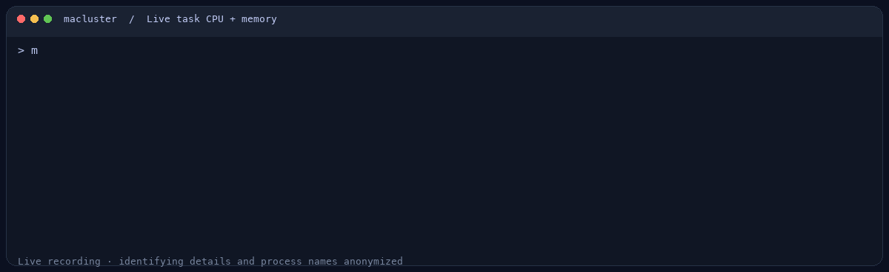

# macluster

将多台 Mac 组成个人计算集群：在一台 Mac 上提交命令，让其他 Mac 执行，并通过终端查看资源和任务。

[English](../README.md) · 简体中文 · [Agent skill](../skills/macluster/SKILL.md)

使用 Rust 编写，只需分发一个二进制。SSH 连接节点，NFS 或 SMB 用来共享项目、软件和外部存储。


*选择节点、展开进程，再切换 CPU 或内存排序。演示来自真实集群录制，机器标识和进程名已匿名处理。*

## 工作方式

```text
登录客户端                        登录 Mac / Controller             计算 Mac
通过固定 SSH 身份运行命令  ───►   命令行 + 后台服务           ───►   每台同时执行一个任务
可选 NFS 挂载             ◄──►   默认提供 NFS 存储           ◄──►   共享项目和软件
```

运行 controller 的 Mac 不加入计算队列。另一台 Mac 可以作为登录客户端加入同一集群，提交和查看任务，但不会变成计算节点。每个任务独占一台计算节点，不限制 CPU 核数或内存。初始化时也可以指定另一台 Mac 提供存储。

项目仍处于早期阶段，面向个人和实验室集群，以 macOS 账户及共享目录作为信任边界。

## 安装

要求：macOS 12 或更新版本；计算节点开启“远程登录”，登录 Mac 可以通过 SSH 连接。仓库中的 `rust-toolchain.toml` 会为源码编译自动安装 stable 编译器、clippy、rustfmt 和 rust-analyzer。

Apple silicon 用户可以通过 Homebrew 安装最新版本：

```sh
brew install FJingxian/macluster/macluster
brew upgrade macluster
```

每次 GitHub Release 发布后，Homebrew tap 会自动更新。Intel Mac 和源码安装使用下列命令。

在准备作为登录节点的 Mac 上进入仓库执行：

```sh
scripts/release/build_signed_macos.sh
packaging/scripts/install-user.sh
export PATH="$HOME/.local/bin:$PATH"
```

构建脚本优先使用 `Developer ID Application` 证书；没有时使用本机已安装的
`Apple Development` 证书。它把代码 identifier 固定为
`org.macluster.macluster`，启用 hardened runtime，并验证 designated
requirement 不依赖会变化的可执行文件 CDHash。`Apple Development` 足以让
本机 TCC 身份稳定；公众下载要完全避免 Gatekeeper 警告，仍需要付费的
Developer ID、公证和[发布说明](releasing.md)中的 secrets。没有 Apple
签名证书时仍可用 `cargo build --release --locked -p macluster-cli`，产物
会是 ad-hoc 签名。

将 PATH 这一行加入 shell 配置，方便后续使用。分发时只需复制 `target/release/macluster`，功耗/风扇 helper 已内嵌。运行 macluster 不需要安装 Rust 或 Python；二进制需要支持目标机器的 CPU 架构。

只复制二进制时可以运行 `macluster 子命令`；`mtop` 这类短命令是安装脚本创建的软链接。使用下载的二进制时，运行 `packaging/scripts/install-user.sh /path/to/macluster "$HOME/.local/bin"`，然后将该目录加入 PATH。

下文使用完整命令；安装脚本也提供 `msub`、`mjob`、`mqueue`、`mkill`、`mtop`、`mnode`、`mfans` 别名。controller 服务命令仍可用于手动维护，但不再显示在主帮助中。

签名、notarization 和 Homebrew tap 的维护流程见[发布说明](releasing.md)。

## 创建集群

```sh
# 在登录 Mac 上执行，按交互提示完成配置。
macluster --init --name home --queue default --shared-root /Users/Shared/macluster

# 将示例中的 SSH 账户和地址换成计算节点的信息。
macluster node -a worker@192.0.2.10
macluster node -l
macluster node -l default-001
```

节点通过 Agent 和共享存储验证后才会进入正式集群。`node -l` 提供紧凑的集群视图；在命令后附加一个节点 ID，可查看该 Mac 的 host、SSH 账户、端口和详细存储信息。加入失败的尝试保留在恢复记录中，可用 `macluster node --failed` 查看错误，再重试原来的加入命令。

所有可由 Agent 管理的 Mac 都会显示在 `mtop`、`mqueue` 和 `mfans` 中，包括没有 compute 角色的 controller 或 login client。`mnode` 的 `ROLES` 只显示 `controller` 和 `compute`，NFS/SMB 所有权统一通过 storage mapping 展示。无法接入统一 Agent 的外部 NFS/SMB 节点只显示为 storage mapping。队列调度资格仍单独判断。`mnode -l --storage` 会以有界并发刷新系统盘、外接盘和已挂载共享的容量；普通 `mnode -l` 优先使用缓存容量。

提交快照会从 controller 本地状态分块发送给存储 Agent；选中的计算 Agent 也会在 `StartJob` 前收到任务脚本。因此，controller 发布和启动任务不再需要直接读取或写入 NFS。任务输入、输出和日志同步仍依赖相关节点能够访问配置的共享存储。

加入节点时会安装 Agent、配置共享空间。若没有 SSH 密钥登录，可在核对指纹并输入远程账户登录密码后安装密钥。NFS 和特权 helper 的配置还可能需要每台相关 Mac 的管理员授权，两者用途不同。

初始化会安装用户级后台 LaunchAgent。关闭终端不影响 controller，注销该 macOS 用户会使服务停止。任务调度需要 controller；查看任务、队列可在它停止时读取已保存的状态。

```sh
macluster controller status
macluster controller start
macluster controller stop
```

`controller run` 用于前台排查。仅需启动服务时不要执行 `macluster --init`：已有配置时，它会询问是否重置集群。

## 将另一台 Mac 作为登录客户端

在另一台 Mac 上运行同一个二进制，加入已有 controller：

```sh
macluster --join cluster-user@192.0.2.1
macluster --clusters
macluster queue
macluster submit hostname
```

加入流程会安装专用 SSH 密钥和只属于该集群的 SSH 主机密钥 pin，并默认挂载主共享和命名 NFS 共享。程序还会安装 root LaunchDaemon，在网络恢复后自动重挂。如果挂载会遮住本机已有文件，macluster 会列出路径并要求输入 `y` 确认。只需要查看队列、任务、节点和监控信息、不希望挂载共享空间时，使用 `--join --control-only`。

局域网内只发现一个兼容集群时，直接运行 `mtop` 等命令会询问是否自动加入。macOS 第一次发现设备时可能请求“本地网络”权限；拒绝只会关闭自动发现，手动 `--join` 仍可使用。

```sh
macluster --cluster home mtop
macluster --cluster home --leave
```

`--cluster` 接受配置名或完整 UUID，并在该命令中覆盖本机 controller 配置。`--leave` 会停止客户端挂载服务、卸载对应共享、撤销该客户端的 NFS 导出和 SSH 密钥，再删除本地 profile。清理失败时 profile 会保留，可重试同一命令。

controller 会记录 SSH 对端 IPv4 地址，只把这个地址加入托管的 NFS 导出。首次加入或地址变化时，controller 或其 NFS 服务器可能请求一次管理员授权。同一个客户端密钥重复加入时会复用原身份。

## 提交任务


*一段完整流程：提交 → 运行 → 完成 → 查看输出。*

```sh
macluster submit hostname                       # 批处理命令
macluster submit job.sh                         # 脚本
macluster submit -q default --node default-001 hostname
macluster submit -Is python --version           # 交互命令，需要真实终端
macluster submit -Is                            # 交互 shell

macluster job                                  # 活动任务
macluster job --all                             # 包括已结束任务
macluster job 1                                # 详情，1 换成实际任务 ID
macluster job --log 1                          # 查看输出
macluster queue
macluster kill 1
```

程序参数放在命令之后。含有重定向、管道等 shell 操作时，加引号让计算节点执行完整命令：

```sh
macluster submit --wrap 'python analysis.py > analysis.log 2>&1'
macluster submit -v python analysis.py          # 开启详细资源日志
```

带时间戳和 CPU/内存的详细日志**默认关闭**，需要时用 `submit -v` 开启。

**文件放在哪里：**在已注册共享目录内提交，就以该目录为工作目录；在共享目录之外提交内联命令，则使用主共享根目录。`--cwd PATH` 可以显式指定共享目录。相对路径结果写在任务工作目录，默认捕获日志在任务结束后同步到主共享目录。计算节点不能直接读取登录 Mac 上任意未共享的文件。

## 实时查看单个任务



*录制使用短时示例任务。无需开启详细日志；关闭订阅后，任务继续运行。*

```sh
macluster job --metrics 1
macluster job --metrics 1 --follow --json
```

通过运行中的 controller 订阅任务进程组的 CPU/RSS，提交时没有加 `-v` 也可以使用。同一任务的多个查看者共用一份约每 5 秒更新的样本；关闭订阅会停止按需采集，不会取消任务。第一次观测还不能计算区间 CPU，值为 null，通常下一次观测后可用。`--follow --json` 每行输出一条 JSON，并在任务结束后退出。

这是实时采样数据，不能补齐订阅前的完整资源历史。RSS 是进程驻留内存之和，可能重复计算共享页；峰值是采样峰值。采集仍有开销，但查看者增加不会重复采集同一个任务。接口和限制见[任务资源订阅说明](job-resources.md)。`job --log --follow` 仍然等待任务结束、日志发布后才读取，并不是实时输出流。

## 共享项目和环境

```sh
# 挂载由 login 节点导出的项目，并在所有节点使用相同路径。
macluster node -mount nfs://login-01/Users/yourname/projects/example \
  --mount-root /Users/yourname/projects/example

# 挂载共享软件环境。
macluster node -mount nfs://login-01/Users/yourname/mamba \
  --mount-root /Users/yourname/mamba
```

在登录终端激活环境，进入共享项目目录，再提交：

```sh
macluster submit -Is python --version
macluster submit -Is pip install -e .
```

`submit` 会继承导出的环境变量，并映射已注册共享路径。**环境变量不会自动共享软件文件**；激活环境在各节点上必须解析到相同的绝对路径。未共享工具链不会被悄悄替换成计算节点自带的软件，标准 macOS 命令仍可使用。`HOME` 会跟随提交任务的 Mac，因此 `~` 会解析到相同的共享路径；shell 别名、函数，以及节点专用的用户名、临时目录、SSH agent 值不会直接继承。

环境变量会随任务保存，请避免导出密钥等敏感信息。不要同时向同一个共享环境安装软件。软件共享挂载可能遮住目标目录里原有的安装，变更前先检查映射。

共享卷需要支持 NFS 导出，例如 APFS；ExFAT 无法导出。受保护目录和外接卷可能需要在**存储 Mac** 上为 `/sbin/nfsd` 开启“完整磁盘访问权限”，授权后在该机重启 nfsd，再重试加入节点。

### 恢复卡死的 macOS NFS 客户端

如果 NFS 挂载仍显示在挂载表中，但文件读取持续返回
`Interrupted system call`（`EINTR`），执行：

```sh
macluster node --repair-nfs COMPUTE_NODE_ID
```

命令使用最长 5 秒的有界探测，只有确认 `EINTR`、目标为 SSH 计算节点且节点
完全空闲时才提供重启恢复。login/controller、storage-only、运行任务和待同步
输出都会被拒绝。输入 `y` 后，Agent 会原子设置任务屏障，特权 helper 调度一次
绑定当前 boot ID 的重启。只有节点断开、重新连接且所有 NFS marker 再次可读时
才报告成功。

无人值守时可加 `--yes`。它只跳过终端确认，不会跳过 wedge、身份、空闲、
输出同步和 boot ID 检查。

NAS 或其他外部存储不需要 SSH 和 Agent，直接用 `-mount` 挂载，不会进入节点列表：

```sh
macluster node -mount smb://nas-user/data --mount-root /Users/Shared/nas-data \
  --host 192.0.2.5 --smb-user nas-user

macluster node -mount smb://192.0.2.5/data \
  --mount-root /Volumes/test_data --smb-user nas-user

macluster node -mount nfs://nas-01/export/data \
  --mount-root /Volumes/nas-data --host 192.0.2.5
```

URI 中的 server ID 可以是逻辑名称，`--host` 指定对应 IPv4 地址或 DNS 名称；也可以直接在 URI 写 IPv4 或 DNS 名称，CLI 会自动建立稳定的内部别名。首次为某个服务器/账户配置时，只在终端中隐藏输入一次 SMB 密码。controller 会把验证成功的主密码保存在 `/Library/PrivilegedHelperTools/org.macluster.credentials` 的 root 专用凭据 vault 中（目录 `0700`、条目 `0600`），再通过已固定身份的 SSH stdin 分发；节点副本也保存在该 Mac 的 root 专用 vault 中。特权 helper 在目标用户的 launchd 安全上下文中运行 `mount_smbfs`，并通过 PTY 喂入密码。交互式命令没有指定 `--smb-user` 时会先询问用户名，直接留空则使用 `guest`，不保存密码；认证失败最多允许输入三次。共享名不存在时会在密码提示前报错，并列出服务器可发现的第一层共享。相同 SMB source 已经挂在其他路径时，CLI 会询问是否复用它来创建新路径；输入 `n` 会取消且不改变现有挂载。密码不会进入集群配置、SQLite、journal、任务环境、命令参数、临时文件或日志。持久挂载由当前用户的 LaunchAgent 调用 helper 恢复；节点重连时会从 login 节点重新接收 root-only 节点凭据。
如果误用 `mnode -a USER@NAS_ADDRESS`，命令会改为提示上述直接挂载方式，不会把 NAS 注册成集群节点。

如果 SMB 挂载仍存在于挂载表中但可读性检查失败，macluster 会执行一次自动替换：
有界卸载、修复同网段路由和 ARP、使用托管凭据重新连接、验证挂载并恢复逻辑路径。
忙碌挂载会保留并报告错误，不会强制卸载；重复失败采用有界退避，避免重挂风暴。

移除 SMB mapping：

```sh
macluster node -umount mnt-0123456789abcdef
macluster node -umount mnt-0123456789abcdef --force
macluster node -umount mnt-0123456789abcdef --force --yes
macluster node -umount mnt-0123456789abcdef --wait --timeout 60
```

默认不阻塞：即使底层 mount busy，也会立即移除 mapping 和对应逻辑路径。
物理清理会在 15、30、60 秒后重试，之后每 5 分钟重试。`--force` 会在普通
卸载失败的节点上询问一次是否强制卸载；`--yes` 用于自动化并跳过询问。
`--wait` 跟踪后台清理，默认最长等待 300 秒。`macluster node --failed`
显示尝试次数、失败类别和下次重试时间。如果 mapping 已经删除，但底层挂载
仍然 busy，可以直接用 `mnode --failed` 显示的待清理 share UUID：

```sh
macluster node -umount CLEANUP_SHARE_UUID --force --yes
macluster node -umount CLEANUP_SHARE_UUID --wait
```

该操作只清理指定的待处理共享，不会误删同一 journal 记录中的其他共享。
配置中已经不存在的旧受管 SMB
helper state 也会自动纳管，避免旧 hidden mount 留下悬空 `~` 路径。

交互式重置遇到尚未配置密钥登录的旧 SSH 节点时，会只询问一次该节点账户密码，安装 macluster 专用重置密钥后继续精确清理。当前本机保存的旧 machine UUID 不一致不会再阻断本地重置。

使用 `--update-credential` 时，新密码必须先强制建立新的 SMB session 并验证成功，才会替换旧主密码；已有挂载不会让错误密码误判为正确。离线节点重连后会自动接收新的 generation；移除某个服务器/账户的最后一个共享时，会安排清理主 vault 与节点 vault 条目。
主密码写入 root 专用 vault 后，后续 helper 升级和节点重连不再重复要求密码。

用 `mnode -l` 查看 mapping ID、标准 source URI 和本机 target。可以用任一端点卸载：

```sh
macluster node -umount mnt-d2d3885d51b734dd
macluster node -umount smb://nas-user/data
```

`mnode --scan` 可以发现集群网段中的 SMB/NFS 服务候选，但不能安全枚举需要认证的 SMB 共享或 NFS exports。可挂载路径需要来自 NAS/存储管理员或已知共享 URI。

旧共享没有 `smb_user` 时，用相同 URI、相同挂载路径和 `--smb-user ACCOUNT` 重新执行 `mnode -mount` 即可原地迁移。原有 share ID 与 UUID 不变，也不会产生重复记录：

```sh
macluster node -mount smb://nas-user/data --mount-root /Users/Shared/nas-data \
  --host 192.0.2.5 --smb-user nas-user
```

## 查看资源

```sh
macluster top                                  # 终端面板
macluster top --once                           # 单次表格
```

终端中，方向键或 `j`/`k` 选择节点，Enter 打开/收起进程详情，`c` 按 CPU 排序，`m` 按内存排序，`q` 退出。进程先显示快速预览，再更新为区间采样结果；预览会注明 CPU 是平均值、内存是 RSS。

CPU 占用为所有逻辑 CPU 之和，例如 8 个逻辑 CPU 最高为 800%。GPU、温度、风扇、功耗取决于硬件与 helper 支持情况，无法获取时显示 `N/A`。

`mqueue` 也可通过 `macluster queue` 使用。

## 管理和维护

| 命令 | 用途 |
| --- | --- |
| `macluster node -l` | 查看正式节点（READY / OFFLINE）和通用 NFS/SMB 映射 |
| `macluster node --failed` | 查看未完成的节点或共享操作及错误原因 |
| `macluster node -rm NODE_ID` | 移除空闲计算节点；托管共享的节点需先迁移存储 |
| `macluster node -rm NODE_ID --connect USER@IP[:PORT]` | 使用新地址连接并核实原机器身份后移除 |
| `macluster node -rm share:SHARE_ID [--force]` | 移除已配置共享或取消未完成配置；`--force` 用于处理仍被进程占用的挂载 |
| `macluster fans --status [--node ID]` | 查看风扇策略与支持情况 |
| `macluster fans --auto [--node ID]` | 按 40–80°C 线性调速 |
| `macluster fans --power [--node ID]` | 按 40–80°C 对数曲线调速 |
| `macluster fans --reset [--node ID]` | 恢复系统风扇控制 |
| `macluster --init` | 确认重置，归档旧状态，然后重新配置 |
| `macluster --init --force` | 允许放弃已结束任务的待同步输出；活动任务仍阻止重置 |

重置清理托管的 NFS/SMB 挂载和导出，并保留共享数据文件；请阅读确认提示。风扇控制使用 AppleSMC 私有接口，支持情况取决于机型，不支持的机器维持系统控制。

本机初始化时会安装功耗采样服务，交互式 `mtop` 也可以单独请求授权来安装或修复；拒绝授权后仍可查看其他资源。功耗读取短暂失败时保留上一笔有效读数，并显示年龄和错误，最长沿用原有的 60 秒有效期。M 系列 MacBook Air 没有风扇，因此风扇转速显示 N/A。

已知 Agent 版本不一致时自动进入更新流程。特权服务具有独立版本，普通 Agent 更新复用当前服务；首次安装、服务升级或修复仍可能需要每台相关机器的管理员授权。程序不保存密码。

需要独立存储 Mac 时：

```sh
macluster --init --name home --queue default \
  --primary-nfs 'storage@198.51.100.10:22:/Volumes/Data/macluster' \
  --shared-root /Users/Shared/macluster
```

存储 Mac 不加入计算队列。同网段 IP 变化时，核实 SSH 信任与机器身份后可以保留节点 ID。交互式 controller 迁移会列出可强制处理的阻滞项并只确认一次；输入 `y` 后会强制取消活动任务和附加会话，把离线 Mac 的 helper 刷新延后交给新 controller，然后完成迁移。目标身份、版本、存储、凭据或旧 controller 停止失败仍会终止迁移。

## 排查问题

| 现象 | 先检查 |
| --- | --- |
| 任务一直等待 | `controller status`、`job JOBID`、`node -l`；队列需要就绪的计算节点 |
| 找不到 Python/编译器 | 登录终端激活了正确环境，软件安装目录已共享 |
| 工作目录不对 | `node -l` 的映射；在共享目录中提交或用 `--cwd` |
| NFS 拒绝导出 | 存储 Mac 的文件系统、目录权限及 nfsd 隐私授权 |
| 登录客户端找不到集群 | 允许“本地网络”访问，或显式运行 `--join USER@HOST[:PORT]` |
| 客户端 IP 变化后共享空间未恢复 | 运行一次依赖存储的命令（例如 `submit`），下一次 controller 连接会更新 NFS 客户端地址 |
| controller 无法启动 | `controller status`，服务日志位于 `~/Library/Logs/macluster/` |

用 `macluster --help`、`macluster submit --help` 查看选项。保留 SSH 主机密钥校验；指纹变化时先核实机器身份，再更新信任记录。

## Agent skill

仓库包含 [macluster skill](../skills/macluster/SKILL.md)，帮助代理检查集群、提交任务、正确使用环境与共享路径并排查失败。

在本仓库执行以下命令，可安装到 Codex：

```sh
mkdir -p "${CODEX_HOME:-$HOME/.codex}/skills"
cp -R skills/macluster "${CODEX_HOME:-$HOME/.codex}/skills/"
```

使用示例：“用 `$macluster` 将当前共享目录中的分析任务提交到集群，并检查结果。”

## 许可证

[GNU GPL v3 或更新版本](../LICENSE)（`GPL-3.0-or-later`）。允许商业使用；分发时需要遵守 GPL 的许可及源码提供要求。
